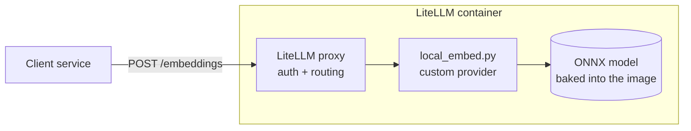
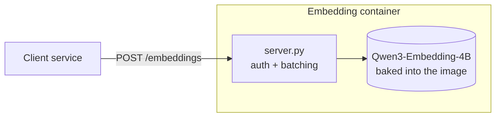

# litellm-local-embeddings

Two ways to serve embeddings locally to a client that calls an OpenAI-style `POST /embeddings` endpoint
and expects 1536-dimension vectors, without a hosted embedding API. Both keep the client contract
unchanged, run on CPU, and need no outbound network at runtime.

| | Option A: LiteLLM with an in-process model | Option B: standalone server |
|---|---|---|
| What runs | LiteLLM proxy, model inside the proxy process | One small FastAPI service, no proxy |
| Default model | `intfloat/e5-small-v2` (Microsoft, MIT, 33M parameters) | `Qwen/Qwen3-Embedding-4B` (Alibaba, Apache-2.0, 4B parameters) |
| Vector | 384 native, zero-padded to 1536 | 2560 native, shortened to 1536 |
| Image | 0.7 GB | 9.5 GB |
| Memory under load | about 2 GB | about 16 GB |
| Use it when | LiteLLM is already the gateway and a small model is enough | A large model is wanted, or the gateway must not change |
| Folder | [`litellm/`](litellm/) | [`standalone/`](standalone/) |
| Test results | [litellm/RESULTS.md](litellm/RESULTS.md) | [standalone/RESULTS.md](standalone/RESULTS.md) |

## Usage

Both options need Docker. The client side is the same for both and is described under
[Calling the endpoint](#calling-the-endpoint).

### Option A: LiteLLM with an in-process model



The build pulls LiteLLM and the model, about 700 MB in total.

```bash
git clone https://github.com/farid809/litellm-local-embeddings.git
cd litellm-local-embeddings/litellm
docker compose up -d --build litellm
```

```bash
curl -s http://localhost:4002/embeddings \
  -H "Authorization: Bearer sk-test-master" \
  -H "Content-Type: application/json" \
  -d '{"model": "amazon.titan-embed-text-v1", "input": "hello world"}'
```

**Another model.** Override the build arguments. The model repository needs an ONNX file,
`tokenizer.json` and `1_Pooling/config.json`. For example, IBM Granite:

```bash
docker build --platform linux/amd64 -t litellm-local-embed:granite \
  --build-arg EMBED_MODEL_REPO=ibm-granite/granite-embedding-30m-english \
  --build-arg EMBED_MODEL_REV=main \
  --build-arg EMBED_ONNX_PATH=model.onnx \
  --build-arg EMBED_PREFIX= .
```

`EMBED_ONNX_PATH` is `model.onnx` or `onnx/model.onnx` depending on the publisher. `EMBED_PREFIX` is the
text the model expects before each input: `passage: ` for E5, empty for most others.

**Native 1536 build (`gte-Qwen2-1.5B-instruct`).** The model is not published in ONNX format, so convert
it once on the host, then build. The conversion downloads about 7 GB and needs roughly 20 GB of RAM. It
loads the model with `trust_remote_code`, pinned to a fixed revision.

```bash
pip install torch==2.5.1 transformers==4.44.2 onnx "numpy<2"     # Python 3.11 or 3.12
python export_onnx.py ./qwen-model
docker compose --profile qwen up -d --build litellm-qwen          # port 4003, give Docker 12 GB
```

**Without compose.**

```bash
docker build --platform linux/amd64 -t litellm-local-embed .
docker run -d -p 4000:4000 -e LITELLM_MASTER_KEY=sk-change-me litellm-local-embed
```

### Option B: standalone server



The build downloads the model, about 8 GB. Give Docker at least 24 GB of memory.

```bash
cd litellm-local-embeddings/standalone
docker compose up -d --build embed
```

```bash
curl -s http://localhost:4004/embeddings \
  -H "Authorization: Bearer sk-test-master" \
  -H "Content-Type: application/json" \
  -d '{"model": "amazon.titan-embed-text-v1", "input": "hello world"}'
```

The first request is served once `GET /health` returns 200; loading the model takes about a minute.

**Without compose.**

```bash
docker build -t embed-server:qwen3-4b .
docker run -d -p 4000:4000 -e EMBED_API_KEY=sk-change-me embed-server:qwen3-4b
```

**Builder without access to huggingface.co**, or to reuse a copy already on disk: put the model files in
`standalone/model/` and add `--build-context model=./model` to the build.

**On a GPU.** The same `server.py` uses a GPU when PyTorch finds one.

```bash
# Apple Silicon, natively (containers on macOS cannot reach the GPU)
pip install torch -r requirements.txt
EMBED_MODEL_DIR=./model EMBED_API_KEY=sk-change-me uvicorn server:app --port 4004

# NVIDIA, in the container (not tested here)
docker build --build-arg TORCH_INDEX=https://download.pytorch.org/whl/cu124 -t embed-server:qwen3-4b-cuda .
docker run -d --gpus all -p 4000:4000 -e EMBED_API_KEY=sk-change-me embed-server:qwen3-4b-cuda
```

### Calling the endpoint

Clients keep whatever already points at an OpenAI-style gateway:

- **URL:** `http://<host>:4000/embeddings`, or base URL `http://<host>:4000` for SDKs. `/v1/embeddings`
  is served as well.
- **Key:** sent as `Authorization: Bearer`, `x-api-key`, `api-key` or `x-litellm-api-key`.
- **Model name:** any name is accepted and answered by the local model.
- **Request options:** `encoding_format` (`float` or `base64`), `dimensions`, a string, a list of
  strings, or token ids as `input`.

Both options answer the same 18 contract checks in [`tests/test_client.py`](tests/test_client.py).

## Results

| | e5-small-v2 (Option A default) | gte-Qwen2-1.5B (Option A, native 1536) | Qwen3-Embedding-4B (Option B) |
|---|---|---|---|
| Parameters | 33M | 1.5B | 4B |
| Contract checks | 18 of 18 | not run | 18 of 18 |
| Embed a small Spring codebase, CPU in a container | 19 s (emulated x86) | 747 s (emulated x86) | 1,391 s (native arm64) |
| Same, CPU natively on the host | 5 s | 318 s | 807 s |
| Same, Apple GPU natively | not run | failed to load | 41 s |
| Clustering of code, mean of 9 scores | 0.38 | 0.36 | 0.38 |
| Clustering of summaries, k-means NMI | 0.40 | 0.41 | 0.44 |
| Search over summaries, right file ranked first | 0.67 | 0.74 | 0.76 |
| Search over summaries, right file in the top 10 | 0.97 | 0.995 | 0.99 |

The quality rows use 390 Java files from three open-source Spring codebases; higher is better. Method,
all scores and limitations are in the two results files:

- [litellm/RESULTS.md](litellm/RESULTS.md): eleven models compared for Option A, plus a follow-up on
  summaries, search and how many dimensions each job uses.
- [standalone/RESULTS.md](standalone/RESULTS.md): Qwen3-Embedding-4B on CPU and GPU, compared with the
  Option A models.

In short: the large models do not cluster better than the small one, and they rank the right search
result first 7 to 9 points more often, at about 60 to 160 times the compute on CPU.

## Configuration

### Option A

[`litellm/config.yaml`](litellm/config.yaml) maps model names to the local provider:

```yaml
model_list:
  - model_name: amazon.titan-embed-text-v1      # name the client sends
    litellm_params:
      model: local-embed/local                  # route to the in-process provider
    model_info:
      mode: embedding
  - model_name: "*"                             # catch-all for any other name
    litellm_params:
      model: local-embed/*
    model_info:
      mode: embedding

litellm_settings:
  custom_provider_map:
    - provider: local-embed
      custom_handler: local_embed.local_embed   # resolved relative to this file's directory

general_settings:
  master_key: os.environ/LITELLM_MASTER_KEY
```

LiteLLM resolves `custom_handler` relative to the config file, so `local_embed.py` has to sit in the same
directory. The image puts both in `/etc/litellm/`. If you mount your own config elsewhere, mount the
handler next to it; otherwise the proxy exits at startup.

| Variable | Default | Purpose |
|---|---|---|
| `LITELLM_MASTER_KEY` | required | API key clients send |
| `EMBED_DIM` | `1536` | Output dimension. Smaller native sizes are zero-padded, larger ones truncated and re-normalised |
| `EMBED_MAX_TOKENS` | `512` | Inputs are truncated to this length |
| `EMBED_PREFIX` | `passage: ` | Text prepended to every input; set by the build for the chosen model |
| `EMBED_BATCH` | `32` (`8` for Qwen) | Texts per inference batch |
| `EMBED_THREADS` | auto | ONNX Runtime CPU threads |
| `EMBED_PROVIDERS` | CPU | ONNX Runtime execution providers, for example `CUDAExecutionProvider` with `onnxruntime-gpu` |

### Option B

| Variable | Default | Purpose |
|---|---|---|
| `EMBED_API_KEY` | required | API key clients send. `LITELLM_MASTER_KEY` is read as a fallback, so one manifest fits both options |
| `EMBED_DIM` | `1536` | Output dimension. The 2560 native values are shortened and re-normalised, which this model is trained for |
| `EMBED_MAX_TOKENS` | `512` | Inputs are truncated to this length. The model accepts up to 32768 |
| `EMBED_PREFIX` | empty | Text prepended to every input. Documents take none; see the note on queries below |
| `EMBED_BATCH` | `8` | Texts per inference batch; concurrent requests share batches |
| `EMBED_DEVICE` | auto | `cpu`, `cuda` or `mps`. Auto picks a GPU when PyTorch finds one |
| `EMBED_DTYPE` | `float32` on CPU, `float16` on GPU | Weight precision |
| `EMBED_THREADS` | auto | PyTorch CPU threads |
| `EMBED_MODEL_NAME` | `Qwen3-Embedding-4B` | Name reported by `/v1/models` |

## Operational notes

Both options:

- **Vectors are not interchangeable between models**, including any hosted model. Build and query an
  index with one model, and re-embed existing data when switching.
- **OpenAI-compatible API only.** Bedrock model names are accepted, but the Bedrock-native `InvokeModel`
  request format is not implemented.
- **Cosine thresholds do not carry over.** Each model has its own similarity range, so any fixed cut-off
  tuned for another model needs re-tuning. Rank-based logic (nearest neighbours, clustering) is unaffected.

Option A:

- **Tested against LiteLLM 1.83.14.** The handler registers itself in an internal LiteLLM list so that
  `encoding_format` and `dimensions` reach it. Rebuild with `--build-arg LITELLM_IMAGE=<image>:<tag>` and
  rerun `litellm/test.sh` when changing versions.
- **The `"*"` route is embeddings-only.** Remove it before adding chat models to the same config.
- **Inference shares the proxy process.** Size the pod's CPU and memory for the model, and cap threads
  with `EMBED_THREADS` if chat traffic goes through the same instance.

Option B:

- **Search queries need an instruction.** Qwen3-Embedding expects queries as
  `Instruct: <task>\nQuery:<text>` and documents as plain text. The API has no field for this, so the
  caller prepends it to queries. Without it, the model card reports a drop of 1 to 5% in retrieval.
- **One inference at a time.** Requests queue and share batches. Throughput is set by the model, not by
  the number of concurrent clients.
- **Long inputs are cut at 512 tokens by default.** Raising `EMBED_MAX_TOKENS` raises memory and latency
  with it.

## Repository layout

```
litellm/       Option A: Dockerfile, Dockerfile.qwen, config.yaml, local_embed.py, export_onnx.py, test.sh, RESULTS.md
standalone/    Option B: Dockerfile, server.py, requirements.txt, test.sh, RESULTS.md
tests/         Shared by both options
  test_client.py   18 contract checks, run from a network with no route out
  stress.py        load test
  embed_dir.py     time to embed a source directory
  quality.py       clustering quality on raw code
  usecases/        summaries, search queries, dimension sweep and search test
results/       Raw output, one folder per option
```

Each option's contract checks run with its own script: `litellm/test.sh` or `standalone/test.sh`.
